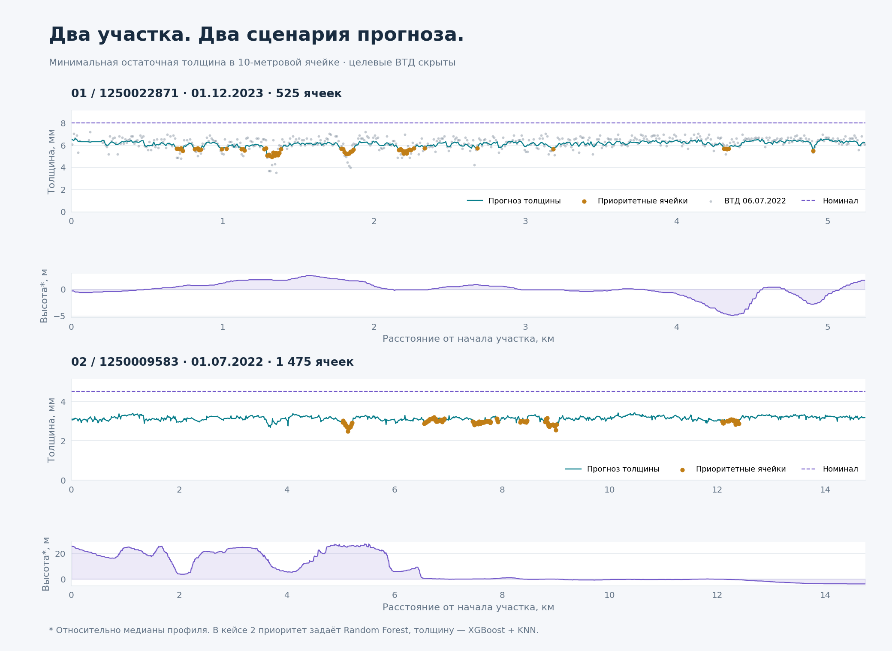
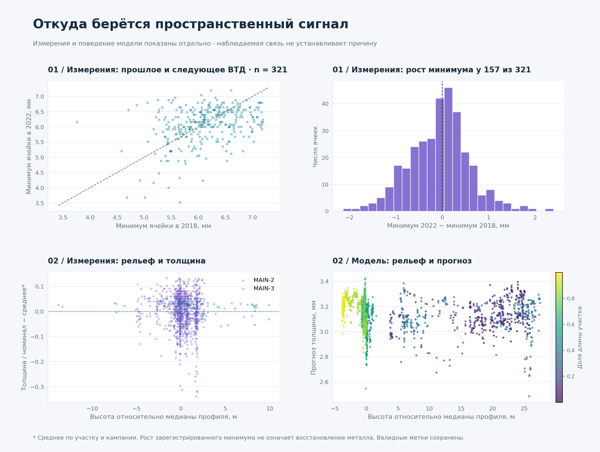
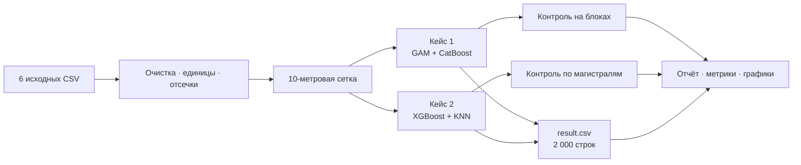

# PipeTwin

**Прогноз остаточной толщины трубопровода — от исходных таблиц до проверяемого результата.**


[Файл сдачи](result.csv) · [Скачать интерактивный отчёт](https://github.com/NordManul/pipeline-degradation-forecast/raw/refs/heads/main/reports/dashboard.html) · [Методика](docs/method.md) · [Очистка и единицы](docs/data-quality.md) · [Как показать решение](docs/visual-guide.md)

## Два кейса, единая система

PipeTwin предсказывает **минимальную зарегистрированную остаточную толщину в миллиметрах** для каждой 10-метровой ячейки. Последняя ячейка участка может быть короче. Файл `result.csv` содержит все **2 000 прогнозов**.

| | Кейс 1 · с прошлым ВТД | Кейс 2 · без прошлого ВТД |
| --- | --- | --- |
| Целевой участок | `1250022871` | `1250009583` |
| Дата прогноза | 01.12.2023 | 01.07.2022 |
| Число ячеек | 525 | 1 475 |
| Номинальная толщина | 8,0 мм | 4,5 мм |
| Итоговая модель | GAM + CatBoost, 50/50 | XGBoost + KNN, 50/50 |
| Источник локального сигнала | Прошлое ВТД, соседние дефекты, режим и рельеф | Относительная координата и рельеф |
| Масштаб толщины | Измеренная история | Номинал и возраст из паспорта |
| Приоритетные 10% | По прогнозу итоговой смеси | По отдельному Random Forest |

> **Что уже проверено:** модели воспроизводятся на открытых контрольных ВТД, файл содержит полную сетку целей, все значения конечны и лежат в паспортном диапазоне. **Что ещё неизвестно:** качество на скрытых целевых ВТД. Pearson² не является «процентом точности».

## Исследовать прогноз

Скачайте [`dashboard.html`](https://github.com/NordManul/pipeline-degradation-forecast/raw/refs/heads/main/reports/dashboard.html) и откройте его в браузере. Всё содержимое встроено в один файл: интернет, сервер и Python для просмотра не нужны. GitHub показывает исходный HTML, поэтому для интерактивного просмотра файл нужно скачать.

- **Профиль участка:** переключение кейсов, масштаб всего участка / 2 км / 500 м, положение окна, просмотр конкретного сегмента.
- **Толщина и рельеф:** согласованная ось расстояния, предыдущее ВТД для кейса 1, номинал и выделенные приоритетные ячейки.
- **Сравнение моделей:** переключение Pearson², знакового Pearson r, MAE и полноты обнаружения тонких ячеек.
- **Проверяемые числа:** скачивание результата, контрольных прогнозов, метрик и данных графиков прямо из отчёта.



Золотые точки обозначают приоритет для обследования. В кейсе 2 их выбирает Random Forest, а показанную толщину и `result.csv` создаёт XGBoost + KNN. Это относительное ранжирование, а не вероятность аварии.

## Проверка качества

| Контроль | Наблюдаемых меток | Pearson r | Pearson² | MAE, мм |
| --- | ---: | ---: | ---: | ---: |
| Кейс 1 · четыре пространственных блока цели, ВТД 2022 | 508 | 0,568 | **0,323** | **0,358** |
| Кейс 1 · поздние ВТД соседних участков, 01.12.2023 | 53 | 0,415 | **0,172** | **0,357** |
| Кейс 2 · отложена вся MAIN-3 | 94 | 0,443 | **0,196** | **0,201** |
| Кейс 2 · среднее по двум магистралям, четырём кампаниям | 1 080 | 0,308 | **0,116** | **0,320** |

В последней строке сначала усредняются метрики кампаний каждой магистрали, затем результаты магистралей. Это **среднее квадратов корреляций**, а не квадрат средней корреляции. Во всех таблицах выше seed 42.


**Кейс 1.** Смесь повышает Pearson² с 0,140 у прошлого ВТД до 0,323 на исторических блоках. MAE снижается с 0,436 до 0,358 мм. Полнота поиска самых тонких 10% — 42%. Поздняя проверка содержит всего 53 метки двух соседних участков. Вариант «уровень + профиль» и Huber дали отдельные улучшения корреляции, но хуже нашли тонкие ячейки на поздней проверке. [Почему оставлена эта смесь](docs/method.md#кейс-1-прогноз-по-прошлому-втд).

**Кейс 2.** XGBoost + KNN повышает средний Pearson² с 0,0486 у контрольного CatBoost до 0,1160 и снижает среднюю MAE с 0,351 до 0,320 мм. На seed 42, 123 и 2024 средний Pearson² смеси — 0,1160 / 0,1114 / 0,1126. Для отдельного списка приоритета Random Forest при seed 42 даёт средний recall 36,7%, смесь — 27,8%. [Устройство переноса](docs/method.md#кейс-2-перенос-между-магистралями).

Все контрольные кампании использовались при исследовании вариантов. Эти результаты показывают работу системы на доступных проверках, но не заменяют независимую оценку скрытых целей.

[Метрики по блокам, кампаниям и seed](reports/metrics.csv) · [Прогноз против факта](reports/predicted_observed.png) · [Устойчивость](reports/stability.png) · [Ошибки по толщине](reports/residuals.png)

## Зависимости, которые видны в данных



**Прошлое ВТД связано со следующим измерением, но минимум ячейки не является траекторией одного дефекта.** Между кампаниями меняются зарегистрированные дефекты, округление и измерения. Поэтому часть минимумов увеличивается. Все валидные метки сохранены, в том числе при росте зарегистрированной толщины. График показывает пары именно целевого участка на исторической проверке, а не все пары обучающей магистрали.

**Рельеф и координата создают пространственный профиль кейса 2.** Для измеренных толщин на графике вычтено среднее отношение толщины к номиналу внутри участка и кампании. Отдельная панель показывает связь высоты с *прогнозом* целевого участка. Это описательные зависимости, не причинные эффекты и не оценка важности признака.

**Ошибки неоднородны.** Четвёртый пространственный блок кейса 1 остаётся трудным. В кейсе 2 доступны только две магистрали для проверки переноса. TECH покрывает 13,3% дней срока службы целевого участка и одинаков по всем его ячейкам. Итоговая смесь кейса 2 не использует TECH, он остаётся входом контрольного CatBoost.

## Как устроен расчёт



- Датированные признаки каждого примера строятся **строго до его даты ВТД**. Преобразования модели обучаются внутри обучающего фолда.
- Кейс 1 проверяется на четырёх непрерывных пространственных блоках с буфером 100 м. Поздние метки присоединяются после обучения и прогноза.
- В кейсе 2 целевая MAIN-4 целиком исключена из доноров. По уточнению правил допускаются более поздние ВТД **других магистралей**. При проверке переноса исключаются все кампании удерживаемой магистрали.
- Паспорт и рельеф считаются заданными статическими входами. Неоднозначность формулировки ТЗ о входах кейса 2 описана в [разборе данных](docs/data-quality.md).
- Пропуск записи ВТД остаётся неизвестной меткой. Он не заменяется номиналом для оценки качества.

## Воспроизвести с нуля

Из корня репозитория, **Python 3.12**, Windows или Linux, CPU x86-64:

```bash
python -m pip install -c requirements-lock.txt -e ".[test]"
python -m pipetwin.pipeline --output artifacts/replay
python -m pytest -q
```

Откройте `artifacts/replay/dashboard.html` в браузере. Каталог вывода должен быть новым. Все графики, числа и HTML создаются в том же запуске, что и прогноз.

Параметры `--data-dir` и `--template` задают каталог исходных таблиц и CSV-шаблон организаторов. Три столбца сдачи: `id,segment_id,thickness_pred`. Нумерация ячеек начинается с нуля отдельно на каждом участке. В материалах нет отдельного шаблона организаторов: текущие ключи и число строк сверены с паспортной сеткой. При передаче шаблона проверяются его ключи и воспроизводится порядок строк.

| Артефакт | Для чего нужен |
| --- | --- |
| [result.csv](result.csv) | Полный файл сдачи |
| [reports/dashboard.html](reports/dashboard.html) | Переносимый интерактивный отчёт |
| [reports/priority_segments.csv](reports/priority_segments.csv) | 53 + 148 приоритетных ячеек и используемая модель |
| [reports/metrics.csv](reports/metrics.csv) | Метрики по проверкам и seed |
| [reports/validation_predictions.csv](reports/validation_predictions.csv) | Факт и прогноз для каждой контрольной метки |
| [reports/profile_data.csv](reports/profile_data.csv) | Координаты, прогноз, прошлое ВТД, рельеф и приоритет |
| [reports/summary.json](reports/summary.json) | Параметры, состав данных и SHA-256 |
| [reports/cleaning.csv](reports/cleaning.csv) | Счётчики срабатываний правил очистки; одна запись может вызвать несколько событий |

## Структура репозитория

```text
src/pipetwin/
  case1.py, case2.py    Подготовка, обучение, изоляция контроля
  models/              Итоговые и контрольные модели
  quality.py           Очистка и временные правила
  plots.py             Шесть воспроизводимых научных графиков
  reporting.py         Данные отчёта, HTML и SVG
  templates/           Интерфейс автономного отчёта
  pipeline.py          Единый запуск и экспорт
configs/, contracts/   Цели, единицы и правила доступности данных
data/raw/              Шесть исходных CSV
docs/task/             Задание и критерии
reports/               Готовые результаты и визуализации
tests/                 Проверки очистки, отсечек, моделей и экспорта
```

[Подробная методика](docs/method.md) · [Ограничения данных](docs/data-quality.md) · [Сценарий демонстрации](docs/visual-guide.md) · [Архив экспериментов](https://github.com/NordManul/pipeline-degradation-forecast/tree/codex/connectivity-check)
