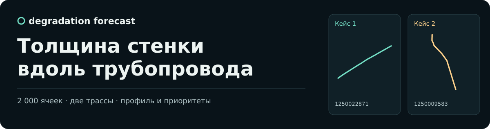

# [degradation forecast](https://github.com/NordManul/pipeline-degradation-forecast)

[](https://nordmanul.github.io/pipeline-degradation-forecast/)

Модель оценивает минимальную остаточную толщину стенки в каждой 10-метровой ячейке. В итоговом файле **2 000 прогнозов** для двух участков.

**[Открыть 3D-модель](https://nordmanul.github.io/pipeline-degradation-forecast/)** · **[Файл сдачи](result.csv)** · [Методика](docs/method.md) · [Данные и единицы](docs/data-quality.md)

## Итоговая сдача

| | Кейс 1 · с прошлым ВТД | Кейс 2 · без прошлого ВТД |
| --- | ---: | ---: |
| Участок | `1250022871` | `1250009583` |
| Дата прогноза | 01.12.2023 | 01.07.2022 |
| Ячеек | 525 | 1 475 |
| Толщина по паспорту | 8,0 мм | 4,5 мм |
| Модель | GAM + CatBoost, 50/50 | XGBoost + KNN, 50/50 |
| **Pearson² на закрытой проверке** | **0,234** | **0,039** |
| **MAE на закрытой проверке** | **0,367 мм** | **0,433 мм** |

Закрытые оценки передала команда по итогам проверки организаторами. В проекте они привязаны к SHA-256 опубликованного `result.csv`. В кейсе 1 модель использует предыдущее ВТД, соседние дефекты, режим и рельеф. В кейсе 2 профиль строится по положению и рельефу с учётом паспорта трубы, обучающие ВТД взяты с других магистралей. [Подробная методика](docs/method.md)

## Посмотреть прогноз в 3D

[Открыть дашборд в браузере](https://nordmanul.github.io/pipeline-degradation-forecast/) · [Скачать HTML для просмотра офлайн](https://github.com/NordManul/pipeline-degradation-forecast/raw/refs/heads/main/reports/dashboard.html)

1. **Откройте вкладку «Кейс 1» или «Кейс 2».** Труба, профиль и метрики обновятся на той же странице. Перетащите трубу для вращения и настройте масштаб высоты. Оттенки поверхности показывают прогноз в миллиметрах по шкале выбранного участка.
2. **Рассмотрите сегмент.** Колесо мыши приближает трубу под курсором, на сенсорном экране работает жест двумя пальцами. Двойной щелчок или кнопка «К сегменту» центрируют выбранный фрагмент. Стрелки в карточке переключают соседние ячейки.
3. **Сравните прогноз с фактом.** В разделе качества есть графики Pearson² и MAE для закрытой и открытой проверок, а также диаграмма контрольных пар. Из отчёта можно скачать данные графиков и файл сдачи.

Ось трассы восстановлена по долготе, широте и высоте из `altitudes_south.csv` с линейной интерполяцией к центрам ячеек. По умолчанию высота отображается с масштабом ×1. Круглое сечение условное, диаметр увеличен. На общем плане цвет берётся из отдельных ячеек, при приближении виден прогноз каждой ячейки. Золотые точки показывают относительный приоритет обследования. В кейсе 2 приоритеты ранжирует отдельный Random Forest, прогноз в файле сдачи формирует XGBoost + KNN.

Шаг сетки и линейка в левом нижнем углу показывают горизонтальное расстояние. Кнопка с диагональными стрелками разворачивает 3D-вид. Повторный щелчок или Esc возвращают его на страницу.

## Открытая валидация

| Контроль | Меток | Pearson² ↑ | MAE, мм ↓ |
| --- | ---: | ---: | ---: |
| Кейс 1 · исторические пространственные блоки | 508 | 0,323 | 0,358 |
| Кейс 1 · поздние ВТД соседних участков | 53 | 0,172 | 0,357 |
| Кейс 2 · среднее по двум удерживаемым магистралям | 1 080 | 0,116 | 0,320 |

Pearson² — квадрат корреляции Пирсона. Для кейса 2 сначала усредняются метрики кампаний одной магистрали, затем метрики магистралей получают равный вес. Контрольные кампании использовались при выборе модели. [Таблица метрик](reports/metrics.csv) · [Пары факт–прогноз](reports/validation_predictions.csv)

## Воспроизвести

Из корня репозитория в окружении Python 3.12:

```bash
python -m pip install -c requirements-lock.txt -e ".[test]"
python -m pipetwin.pipeline --output artifacts/replay
python -m pytest -q
```

Откройте `artifacts/replay/dashboard.html`. Для повторного запуска укажите новый каталог. Опция `--template` принимает шаблон сдачи с ключами организаторов. По умолчанию сетка строится по паспорту.

| Где смотреть | Содержимое |
| --- | --- |
| [src/pipetwin](src/pipetwin) | Очистка, обучение, контроль и генерация отчёта |
| [contracts](contracts) · [configs](configs) | Единицы, временные правила и настройки |
| [data/raw](data/raw) · [docs/task](docs/task) | Шесть исходных таблиц, задание и критерии |
| [reports](reports) | Готовый HTML, профили, приоритеты, метрики, аудит очистки |
| [tests](tests) | Очистка, временные отсечки, модели и сверка экспортов |
