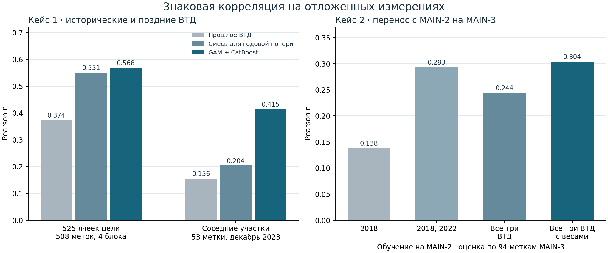

# PipeTwin — прогноз остаточной толщины стенки

[Скачать result.csv](result.csv) · [Методика и отсечки](docs/method.md) · [Очистка и единицы](docs/data-quality.md)

Файл сдачи содержит 2 000 прогнозов минимума остаточной толщины в миллиметрах на 10-метровой сетке. Последняя ячейка может быть короче 10 м.

| Кейс | Участок | Дата ВТД | Ячеек | Модель |
| --- | --- | --- | ---: | --- |
| 1 | `1250022871` | 01.12.2023 | 525 | Смесь прямых прогнозов GAM и CatBoost 50/50 с прошлым ВТД |
| 2 | `1250009583` | 01.07.2022 | 1 475 | CatBoost на годовой относительной потере с весами магистралей и кампаний |

Столбцы файла в порядке сдачи — `id`, `segment_id`, `thickness_pred`. Нумерация начинается с нуля отдельно на каждом участке. Ключи и количество строк сверены по паспортной сетке. Шаблон организаторов отсутствует в исходных материалах. Для проверки ключей и порядка по нему предусмотрен параметр `--template`.


## Проверка качества

| Проверка | Меток | Pearson r | Pearson² | MAE, мм |
| --- | ---: | ---: | ---: | ---: |
| Кейс 1 · четыре пространственных блока целевого участка, ВТД 2022 | 508 | 0,568 | 0,323 | 0,358 |
| Кейс 1 · соседние участки, ВТД 01.12.2023 после заморозки прогноза | 53 | 0,415 | 0,172 | 0,357 |
| Кейс 2 · вся MAIN-3 отложена | 94 | 0,304 | 0,093 | 0,209 |

Кейс 1 на пространственных блоках находит 42% действительно самых тонких 10% ячеек. Для кейса 2 этот показатель на MAIN-3 составляет 40%. При переносе в обратную сторону, с MAIN-3 на кампании MAIN-2, знаковый r варьируется от 0,031 до 0,104. Скрытые целевые ВТД нужны для измерения конкурсного качества. [Метрики по кампаниям и блокам](reports/metrics.csv)



## Воспроизведение

Из корня репозитория в активном окружении Python 3.12:

```bash
python -m pip install -c requirements-lock.txt -e ".[test]"
python -m pipetwin.pipeline --output artifacts/replay
python -m pytest -q
```

Команда читает шесть исходных файлов из `data/raw`. В новом каталоге появляются `result.csv`, `profiles.png`, `validation.png`, `metrics.csv`, сводка очистки `cleaning.csv` и `summary.json` с хешами исходных CSV и результата. Другой набор входов можно указать через `--data-dir`, шаблон организаторов — через `--template`. [Параметры проверенного запуска](reports/summary.json)

## Файлы проекта

| Путь | Содержимое |
| --- | --- |
| [src/pipetwin](src/pipetwin) | Очистка, признаки с временной отсечкой, обе модели и экспорт |
| [configs](configs), [contracts](contracts) | Цели, единицы, геометрия и правила доступности данных |
| [data/raw](data/raw), [docs/task](docs/task) | Исходные таблицы, задание и критерии |
| [reports](reports), [tests](tests) | Графики, контрольные метрики и тесты |
