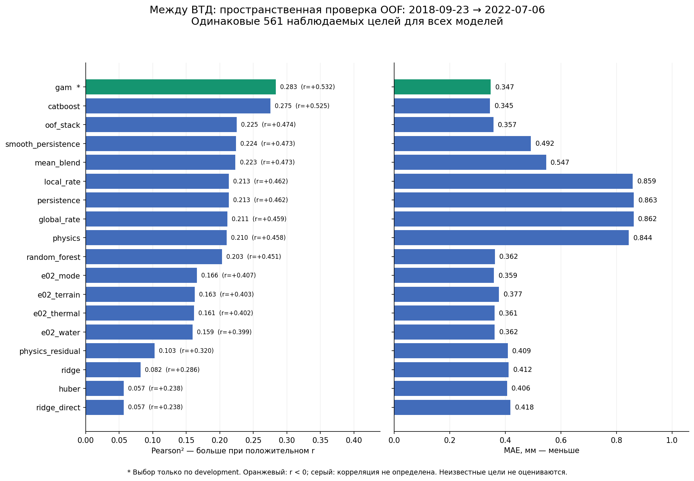
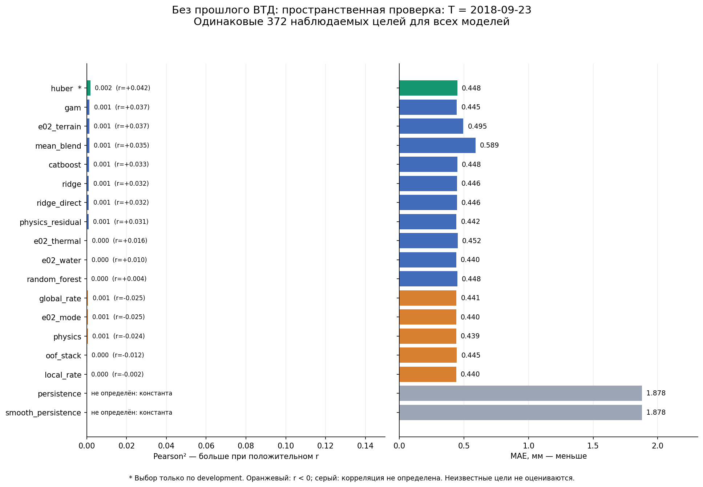
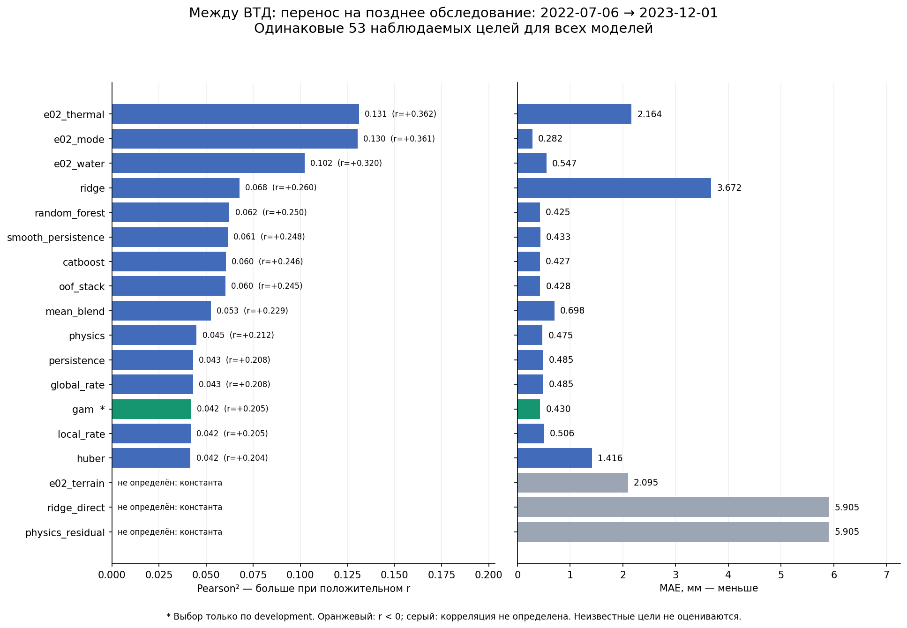
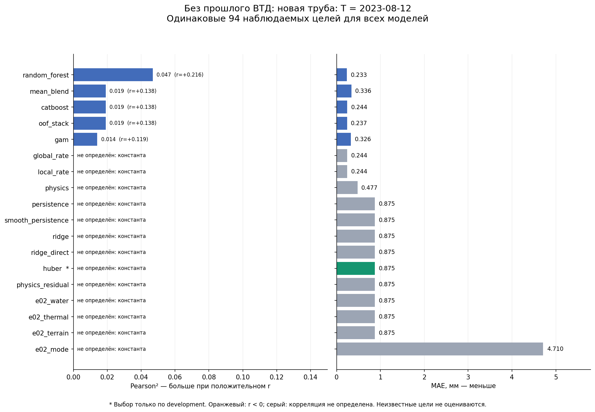
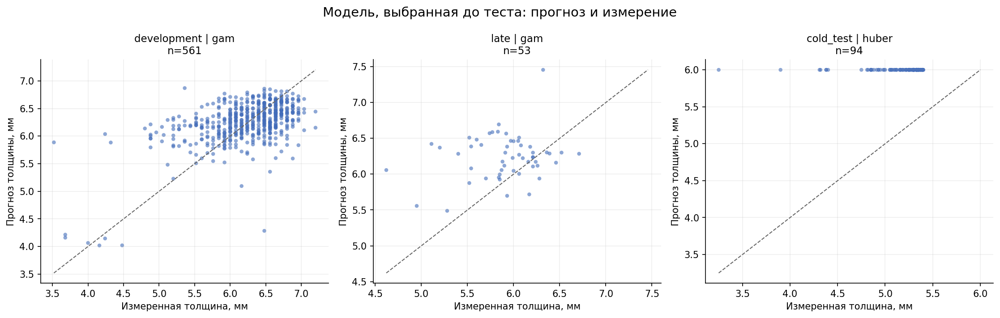
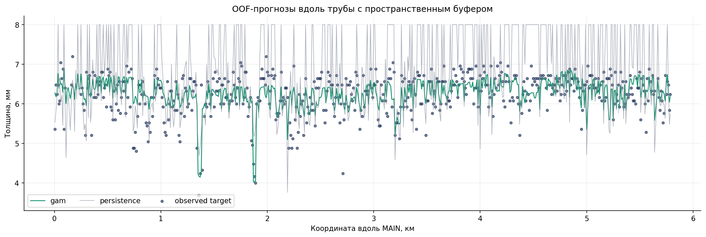
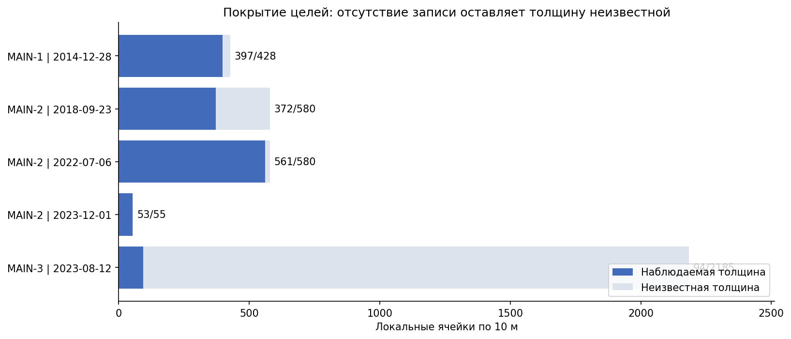
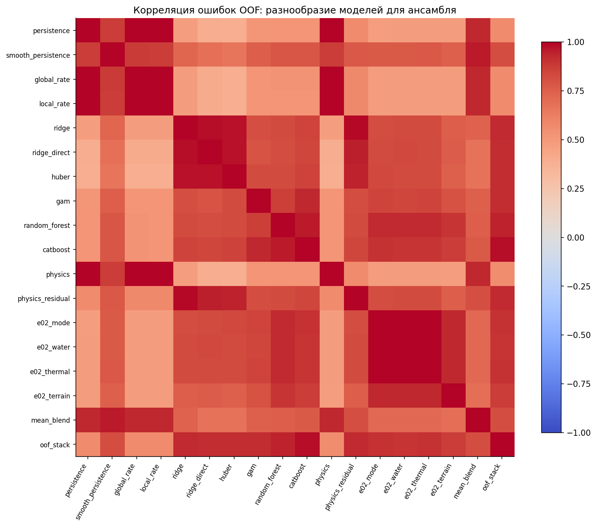

# Исторический прототип PipeTwin

Выбор модели и весов выполнен по пространственным OOF-прогнозам до оценки поздней кампании и другой трубы.

| Проверка | Зафиксированная модель | n | Pearson r | Pearson² | MAE, мм |
| --- | --- | ---: | ---: | ---: | ---: |
| development | gam | 561 | 0.5324 | 0.2834 | 0.3475 |
| late | gam | 53 | 0.2048 | 0.0419 | 0.4297 |
| cold_development | huber | 372 | 0.0421 | 0.0018 | 0.4482 |
| cold_test | huber | 94 | не определён | не определён | 0.8751 |

Сравниваются 16 отдельных кандидатов и два ансамбля. Рейтинг всех моделей находится в `metrics.csv`.
Каждый кандидат оценён на одной и той же маске наблюдаемых целей; пропуски не заполнены номиналом.
Предсказания ограничены диапазоном от 0 до проверенного паспортного номинала.

Development — пространственная проверка перехода 2018-09-23 → 2022-07-06 с буфером 100.0 м.
Это оценка пространственного переноса внутри известного перехода, а не полностью временной backtest.
Late — перенос на следующую доступную кампанию после фиксации модели. Cold test — другая труба без прошлого ВТД.
Размечено 94 из 2185 ячеек cold test. Политика цели: `reported_residual`.
Состав типов дефектов и маска целей требуют подтверждения; рейтинг не доказывает прогноз будущей внутренней коррозии.

Режимы используются строго до даты T; для будущего T потребуется сценарий будущего режима.
Поздние данные ранее проходили аудит. После просмотра этих результатов повторный подбор будет исследовательским.
ID, даты, сетка и состав официальной конкурсной цели пока не подтверждены; `selected_predictions.csv` — исторический результат.

Интервалы построены по 10%/90% квантилям OOF-остатков выбранной модели. Подбор модели и калибровка используют одни OOF-данные;
это диагностические интервалы без гарантии 80% покрытия, особенно при переносе на новую трубу.

- late: покрытие интервала 73.6%, средняя ширина 1.089 мм.
- cold_test: покрытие интервала 23.4%, средняя ширина 0.670 мм.

## Графики

